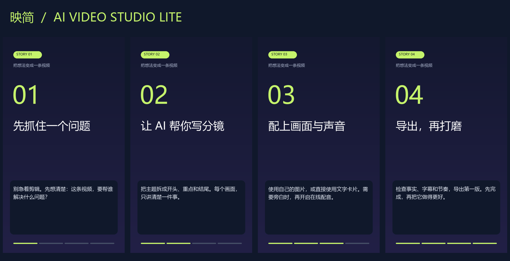

# 映简 · AI Video Studio Lite

**把主题变成分镜，把分镜变成一条可发布的短视频。**

一个轻量的中文桌面工具：连接你自己的大模型生成脚本，检查并修改分镜，再自动合成文字卡片 / 自选图片、旁白、字幕和 MP4。适合知识分享、产品介绍、办公技巧和教程开场。



[下载约 25 秒的静音示例视频](docs/demo.mp4) · [示例分镜](examples/storyboard.json)

## 已实现

- 中文桌面界面，也可以通过命令行使用。
- 通过 Chat Completions 兼容接口生成中文分镜，支持自定义地址、模型和密钥。
- 内置离线示例，不需要模型密钥即可完成静音视频导出。
- 原创渐变文字卡片、分镜标题、画面内字幕与淡入淡出。
- 每个分镜可使用自己的本地图片，自动裁剪适配画面。
- 可选在线中文配音，画面时长会延长以容纳完整旁白。
- 输出 H.264 / AAC MP4、SRT 字幕、分镜 JSON、时间轴和中间素材。
- 720×1280 竖屏、1280×720 横屏居中卡片、360×640 快速预览。

当前版本通过 AI **生成脚本**，再用本地程序合成视频；没有接入文生视频或图生视频模型。横屏采用居中竖版卡片，两侧留边。字幕为分镜级字幕，不是逐字卡拉 OK。

## 快速开始

需要 Python 3.10+。Windows 通常自带 Tkinter；Linux 桌面可能需要安装 `python3-tk`。核心依赖会安装带 FFmpeg 的平台 wheel，常见 Windows / macOS / Linux 环境无需另装 FFmpeg；特殊平台可通过 `IMAGEIO_FFMPEG_EXE` 指定可用程序。

```bash
git clone https://github.com/czccsz/ai-video-studio-lite.git
cd ai-video-studio-lite
python -m venv .venv
```

Windows PowerShell：

```powershell
.\.venv\Scripts\Activate.ps1
python -m pip install -e .
python -m aivideo gui
```

如果系统不允许激活脚本，可直接运行 `.\.venv\Scripts\python.exe -m pip install -e .` 和 `.\.venv\Scripts\python.exe -m aivideo gui`。

macOS / Linux：

```bash
source .venv/bin/activate
python -m pip install -e .
python -m aivideo gui
```

进入界面后，先点“加载示例”，再点“导出 MP4”。软件会在你选择的位置创建独立的时间文件夹，不覆盖已有视频。

## 无需密钥，先导出第一条视频

```bash
python -m aivideo demo --profile preview --output renders/first-video
```

使用全新输出目录；已存在时程序会拒绝覆盖。得到：

```text
first-video/
├── video.mp4
├── subtitles.srt
├── storyboard.json
├── timings.json
└── assets/          # 卡片图片、各段视频和可选配音
```

Windows 自动查找微软雅黑，macOS 查找苹方，Linux 查找 Noto Sans CJK / 文泉驿。未找到中文字体时，用 `--font /path/to/font.ttc` 指定；桌面界面有“选择中文字体”按钮。字体不随本项目分发。

## 用 AI 写分镜

界面中填写基础地址、模型名称和接口密钥，输入主题，再点击“AI 生成分镜”。**模型名称请以你使用的服务商当前提供的名称为准。** 基础地址不包含 `/chat/completions`，例如 `https://api.deepseek.com`；使用其他兼容服务时，可以填服务商要求的 `/v1` 基础地址。

命令行通过环境变量读取配置，避免把密钥放入命令参数或源码：

```powershell
$env:AI_BASE_URL = "https://api.deepseek.com"
$env:AI_MODEL = "服务商提供的模型名称"
$env:AI_API_KEY = Read-Host "接口密钥" -MaskInput # PowerShell 7+
python -m aivideo plan "面向新手，用 30 秒介绍三个办公效率技巧" -o my-story.json
python -m aivideo render my-story.json --output renders/my-video
```

Windows PowerShell 5.1 可在桌面界面的密钥输入框填写，或使用系统环境变量设置；不要把真实密钥提交到 GitHub。

本地兼容模型服务可使用 `http://localhost:端口/v1`，本机服务允许省略密钥。远程接口要求 HTTPS。模型生成的内容不会自动执行命令，也不会决定本地图片路径。

## 配音

```bash
python -m pip install -e ".[voice]"
python -m aivideo demo --voice zh-CN-XiaoxiaoNeural --output renders/with-voice
```

配音使用第三方项目 [edge-tts](https://github.com/rany2/edge-tts) 接入在线语音服务，需要联网，服务可用性取决于网络和服务方。开启后，每段旁白会发送给语音服务；失败时明确报错，并保留已保存的分镜，不会悄悄改成静音。默认关闭。

## 使用自己的图片

在分镜里添加 `image` 字段。相对路径以 JSON 文件所在目录为基准；桌面编辑器中手动添加时建议使用完整路径。

```json
{
  "title": "今天的办公技巧",
  "scenes": [
    {
      "heading": "先完成最重要的事",
      "narration": "每天开始工作前，先列出一件必须完成的事，把注意力留给它。",
      "duration": 8,
      "image": "images/desk.jpg"
    }
  ]
}
```

支持 1–12 个分镜，每段设定时长 3–30 秒；配音较长时实际时长自动延长。标题最多 60 字，分镜标题 32 字，旁白 120 字。只有自己填写的本地图片会被读取；模型响应中的图片路径会被丢弃。

## 数据与费用

画面生成和视频合成在本机完成。请求 AI 分镜时，主题会发送到你配置的模型服务；模型 API 可能按服务商规则收费。密钥只在进程内使用，不写入配置文件或分镜。程序不采集使用数据，没有遥测。分镜和中间素材会保存在输出目录，分享前可以检查内容。

## 验证与开发

```bash
python -m unittest discover -s tests -v
```

测试包含分镜校验、模型响应与错误处理、本机 HTTP 模型替身、真实 FFmpeg 导出和完整解码验证。在线模型和在线语音不在离线测试中调用。Windows 是当前主要验证环境，macOS / Linux 仍需实际桌面使用反馈。

```text
aivideo/
├── gui.py          # 中文桌面界面
├── planner.py      # 模型接口
├── storyboard.py   # 分镜校验与示例
├── cards.py        # 画面绘制
├── render.py       # 配音、字幕和视频合成
└── __main__.py     # 命令行入口
```

欢迎通过 Issue 提交问题和建议。贡献方法见 [CONTRIBUTING.md](CONTRIBUTING.md)。

## 后续方向

- 横屏专用版式与更多主题。
- 本地语音引擎与背景音乐混音。
- 可配置的文生图 / 文生视频服务接入。
- 可视化分镜编辑和画面预览。

以上为计划，不属于当前版本已提供的功能。

## 许可与依赖

项目代码及原创示例使用 [MIT License](LICENSE)。图像绘制使用 [Pillow](https://github.com/python-pillow/Pillow)，视频程序由 [imageio-ffmpeg](https://github.com/imageio/imageio-ffmpeg) 提供，均需遵守各自许可；FFmpeg 的具体构建和许可见对应发行说明。第三方模型、语音服务和你导入的图片不受本项目 MIT 许可覆盖。
